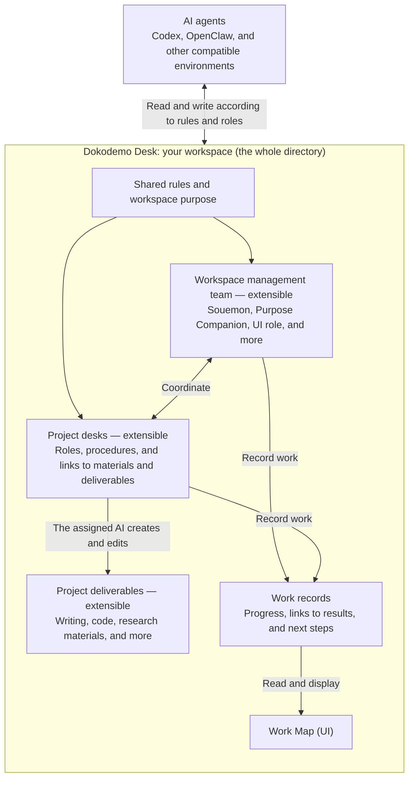

# Dokodemo Desk｜どこでもデスク

[日本語](README.md) | English

**A workspace that grows with you and your AI companions.**

Dokodemo Desk brings your purpose, roles, and work records into a workspace you can carry with you. Start with Souemon, your guide to setting up the workspace and welcoming new companions as your work calls for them. Together, you shape how the team works and use a shared view to see its progress.

You don’t need to know your destination from the start. Work together, notice what matters, and let your purpose take shape along the way.

This is the **initial public release**, based on the v0.2 template. It includes a workspace generator, a local UI, and guides for getting started and resuming work, under the MIT License. It brings together improvements from the MVP and starts with an independent Git history on October 10, 2026.

The revised onboarding flow and resuming work in a dedicated chat have been checked in an existing user’s Codex environment on macOS. We have also received an OpenClaw test report describing successful retrieval, workspace generation, HTML serving over HTTP, all 14 tests, and an onboarding exercise. Browser rendering and human visual checks in OpenClaw, and onboarding with new human users, remain unverified. See the [validation record](VALIDATION.md) for the scope of these checks.

This is the English introduction and setup guide. The [Japanese README](README.md) is the source version; the template documents, UI, and linked guides are currently in Japanese.

## How Dokodemo Desk is organized

**Dokodemo Desk is your own directory where different AI agents can access the files, work on tasks, and create or edit deliverables.** An AI with read and write access takes on work by reading the shared rules, role definitions, and records.



The management team supports the whole workspace; each desk handles its own project. Roles, records, and deliverables stay in the workspace, so another AI can pick up where the previous one left off. One AI can also take on several roles.

Within the workspace as a whole, the `workspace/` folder holds the files used to organize the work. The current template uses this layout:

| Content | Location |
|---|---|
| Shared rules and purpose | `workspace/constitution.md`, `workspace/rules.md`, `workspace/purpose.md` |
| Management team roles | `workspace/agents/roles/` |
| Project desks | `workspace/agents/desks/` |
| Project deliverables and materials | Each project’s folder inside `projects/` |
| Work records, daily reports, and shared boards | `workspace/operations/` |
| The Work Map display program | `console/` |

Add roles, desks, and deliverables as your work calls for them. A blank workspace includes Souemon and the UI role; the Purpose Companion is added during onboarding. The diagram shows how roles and files relate. It does not describe an automatic agent launcher or a mechanism for coordinating simultaneous edits to the same file.

## Think of it as a voyage on a small ship

The roles in Dokodemo Desk are a little like the crew and tools aboard a small ship.

- **The ship — Dokodemo Desk**

  Your own workspace, kept on your computer and ready to travel with you.
- **The captain — Souemon**

  A dependable organizer who keeps the ship running. When you need help, Souemon works with you to figure out what kind of companion you need and welcomes them aboard.
- **The compass — your Purpose Companion**

  A role that helps you discover what matters to you and where you want to go, through your words and the work you do with your companions. It records those insights and helps you use them to choose your next course.
- **The chart — the Work Map (UI)**

  A view of who is responsible for what and how far the work has progressed.
- **The sails and wind — AI**

  The driving force that helps move your work forward.
- **The traveler — you**

  You choose where you want to go, enjoy the scenery, and make the voyage your own.
  (Sometimes, perhaps, you’re the seagull feeling the wind at the top of the mast.)

You add companions as your work develops, defining their roles and how to ask them for help along the way.

### Discovering your purpose through work

It’s fine if you can’t put your destination into words at the start. Here’s a fictional example of how things might unfold at a small inn.

1. **The first conversation:** “Managing reservations is such a hassle.” Work begins with a reservations desk.
2. **A week later:** While sorting out the reservation process, the team notices how many phone calls ask the same questions. They put together an FAQ.
3. **A month later:** It becomes clearer that an aging staff and the burden of handling inquiries have left little breathing room. The owner says, “I want to preserve the warmth of this inn.” That gives the efficiency work a deeper sense of direction.

The reservations desk and an operations improvement role handle the reservation process and FAQ. The Purpose Companion connects the wishes and priorities that emerge across those efforts, helping guide what comes next.

When something clicks, you can simply tell the AI you’re talking to, “Please have the Purpose Companion record this.” The AI may also notice a connection and say, “Perhaps this is something that matters to you.” You keep what emerges from that exchange as you work together. You don’t need to settle your purpose at the beginning or revisit it in every conversation.

The workspace’s `workspace/purpose.md` serves as the ship’s log for that journey. It holds your current understanding of your purpose and the path that led there. Your own words and the AI’s interpretations stay distinct, and earlier insights remain traceable. Recording happens in response to a request or an insight during a conversation, using conversations and work records the AI can access. Automatic scanning of all chats and scheduled background runs are not built in.

## Who it’s for and what you need

**Start by getting the project from GitHub and working with an AI on your computer.** You don’t need to be comfortable with Git commands: you can give the repository URL to your AI and ask it to help you set up.

You need an AI that can read and write the workspace folder, Python 3.9 or later, a browser for the local UI, and a place to keep the files so the AI can read them again next time. Alongside the initial Codex trial on macOS, technical checks and an onboarding exercise have been reported from OpenClaw on macOS 15.7.3 (Apple Silicon) with Python 3.9.6. Environments such as Antigravity and Hermes are also intended candidates when they provide these capabilities; compatibility needs to be checked in each environment.

Setting up entirely through a cloud-only or phone-only chat is outside the current scope. Remote access to an already prepared workspace is a future area for testing. “Dokodemo” means “anywhere”: the aim is to let you carry your own purpose, roles, and records into a compatible environment and continue working.

A plugin is a possible future way to make the project easier to find and set up. It is not required to use the project, and does not imply availability in every chat app or an official quality endorsement.

## Ask your AI to help you get started

Give the following request to an AI you use on your computer:

> Get Dokodemo Desk from https://github.com/kentaroid-bot/Dokodemo-Desk, read its README, and guide me through it as Souemon. Create my workspace in a separate new folder and help me get as far as seeing the first screen.

The AI should read [Souemon’s role](template/workspace/agents/roles/general-affairs.md) and the [onboarding guide](template/workspace/agents/workflows/onboarding.md). The purpose and work included in this repository’s template are fictional practice examples. Generate a blank workspace as described below, then follow its START.md, AGENTS.md, and onboarding record. Do not treat the examples as the user’s own purpose or work.

Choose where to keep the workspace, then create a Purpose Companion from the concerns and wishes already known. That understanding can grow as you work. Souemon and the UI role are included from the start, so there is no need to create duplicates. The AI should explain the difference between defining a role, taking on that role in the current conversation, and starting a separate chat.

Setting up the workspace becomes its first recorded task. The AI helps you find the roles, results, and ways to continue on the screen. Names and conversational style can be adjusted as needed; you don’t have to answer every setup question before getting started. For ongoing work, the AI can suggest a dedicated chat that makes it easier to return to the task. Continuing in the same chat is also an option.

Souemon puts roles that support the whole workspace into role documents. Specialists, such as a writer, can have a desk that combines their role definition and work guide. Ask for a writer, for example, and you can begin with a writing desk. See [shared roles and specialist desks](template/workspace/agents/roles-and-desks.md).

## Get the project

With Git, run the following. You do not need to sign in to GitHub to download this public repository.

```text
git clone https://github.com/kentaroid-bot/Dokodemo-Desk.git
cd Dokodemo-Desk
```

Without Git, use **Code → Download ZIP** on GitHub and extract the archive.

To try a particular version, check out the specified commit before starting. The downloaded folder contains the distribution template. Create your own workspace somewhere else; you can decide later whether to save it to your own GitHub repository.

## Create a workspace

Use Python 3.9 or later. No additional libraries or UI sign-in are required. Run this from the downloaded project folder:

```text
python3 -B create_workspace.py ../my-workspace --name "Our workspace" --blank
```

Replace the name and destination with your own. If the destination already exists, the generator stops without overwriting it. After generation, ask your AI to read START.md in the new workspace.

A blank workspace contains just two roles: Souemon and the UI role. Your Purpose Companion is the first role added through conversation with you. To practice with a fictional studio, generate an example workspace in a different folder:

```text
python3 -B create_workspace.py ../practice-workspace --name "Practice studio"
```

The example workspace has four roles, including a fictional Purpose Companion and a quotation desk, along with sample work, a daily report, and a circular. Keep it separate from your real workspace so fictional records don’t carry over into your work. The `--name` option changes the workspace name; it does not translate the UI or template documents.

## Open the Work Map

Run the following from **the generated workspace folder**, then open http://127.0.0.1:8772 in your browser:

```text
python3 -B console/server.py
```

If another workspace is using that port, choose an available one, for example with `--port 8773`. To stop the server, press Control+C in the terminal where you started it.

The UI shows roles, work, daily reports, shared boards, and guides. It rereads the source files when you open the screen or click **記録を更新** (“Refresh records”). The registry lists defined roles, not the number of AI agents currently running. Notifications, persistent background operation, automatic startup of other chats, and model usage tracking are not connected.

## Guides and next steps

The following documents are currently in Japanese.

| Document | What it covers |
|---|---|
| [START.md](template/START.md) | Getting started and resuming in a generated workspace |
| [Saving and resuming](template/workspace/recovery/github.md) | Choosing between your private GitHub repository, local files, and ZIP archives |
| [Onboarding design](docs/onboarding-design.md) | The agreed flow from getting the project to the first task, roles, and ways to continue |
| [Plugin concept](docs/plugin-design.md) | A possible optional distribution route alongside GitHub |
| [First-run test plan](docs/first-run-test.md) | Initial trial observations and planned checks with new users, handoffs, and different computer environments |
| [Validation record](VALIDATION.md) | Technical checks for the public release, MVP trials, and remaining checks |
| [Changelog](CHANGELOG.md) | Recorded releases, design decisions, and implementation changes |

## For developers

```text
python3 -B -m unittest discover -s tests -v
node --check template/console/app.js
```

Node.js is used for JavaScript checks during development. It is not required to run a workspace.

This public repository is the source for future template development. Keep users’ own purposes, roles, and work out of the distribution template, and preserve their edits when updating a workspace.

Report bugs and suggestions in [Issues](https://github.com/kentaroid-bot/Dokodemo-Desk/issues), with reproduction steps and environment details. Use fictional examples and leave out private work records and credentials.

## License

The code, documentation, and templates are provided under the [MIT License](LICENSE). Generated workspaces include the same license notice. This does not automatically apply the license to the purposes, work records, or other content you create yourself.
